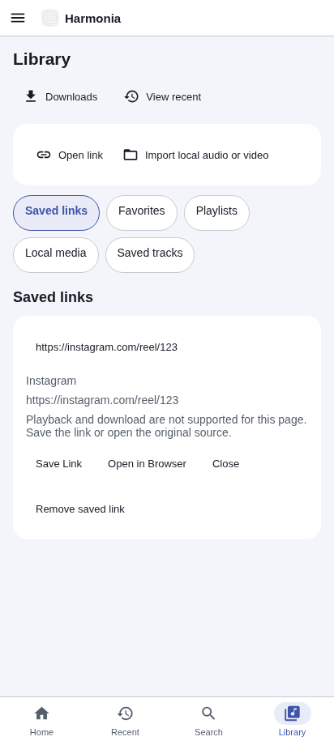
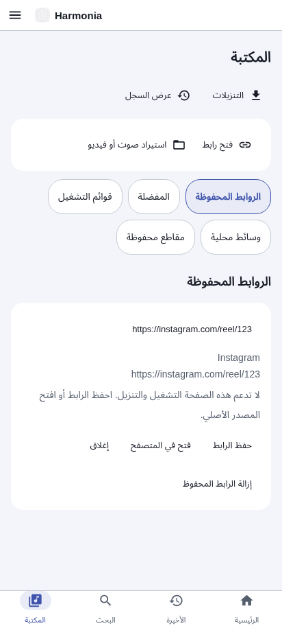

# Harmonia 2.0 preview delivery report

## Scope and baseline

This is the first focused PR of the roadmap, not a completed Harmonia 2.0 release. Baseline main: `ecf20e0` (v1.5.0). Branch: `feat/harmonia-v2-universal-media`. App: `2.0.0-preview.1`, Android versionCode 7, unchanged `com.alhudar.harmonia` package. The existing production signing plugin and key configuration were not modified; no production key was generated, inspected or committed.

[Audit findings and phased acceptance gates](HARMONIA_V2_AUDIT.md) distinguish source-confirmed gaps from unverified runtime risks. Existing NewPipe search/formats, private offline files, playlists/history/favorites, playback queues, background audio/PiP, themes and bilingual infrastructure are retained. Browser regression results do not prove their native behavior.

## Implemented

- Extend the existing intent bridge with a bounded pending FIFO, early launch-share retention and browser-selector dispatch. Subscribe/drain on launch and foreground; deduplicate tokens, permit independently repeated shares and support multiple links in text.
- Offline provider registry identifies supported YouTube video routes, HTTPS media-file candidates and social/web pages. YouTube uses existing metadata/format interfaces. Unknown/social pages never acquire fabricated playback/download capabilities. HLS/DASH candidates remain playback-only; HTTP remains browser/save-only.
- Explicit action sheet offers only applicable actions; YouTube downloads prompt for an available format. Playback starts after user action. Failures retain source errors and browser fallback rather than being mislabeled as unsupported platforms or successful files.
- Saved links live separately from playable tracks and download records, with Library UI, remove/deduplicate behavior, legacy-key additive migration and URL revalidation on load.
- Reject credentials, IP literals, common local/internal namespaces, unsafe schemes and nonstandard ports. This is input hardening, not complete DNS/redirect enforcement.
- New UI strings translated into Arabic; existing theme and RTL components reused.

## Files changed

| Area | Files |
| --- | --- |
| Audit/documentation | `docs/HARMONIA_V2_AUDIT.md`, `docs/HARMONIA_V2_ARCHITECTURE.md`, `docs/HARMONIA_V2_IMPLEMENTATION.md`, `README.md`, `CHANGELOG.md` |
| Sharing | `utils/linkProviders.ts`, `utils/incomingLinks.ts`, `components/IncomingLinks.tsx`, `components/SharedLinkCard.tsx`, `native/youtube/IntentModule.java`, `app/+native-intent.tsx` |
| Persistence/library/input | `store/playerStore.ts`, `app/(tabs)/library.tsx`, `types/media.ts`, `utils/i18n.ts` |
| Release metadata | `app.config.js`, `package.json`, `package-lock.json` (version metadata only; dependency versions unchanged) |
| Tests | `tests/linkProviders.test.ts`, `tests/library.test.ts`, `tests/browser/player.spec.ts` |
| Screenshots | `docs/images/sharing-en.png`, `docs/images/sharing-ar.png` (browser saved-link flow, not Android captures) |

Generated `android/`, `dist/`, test results and build logs are not source changes.

## Executed validation

| Check | Outcome |
| --- | --- |
| `npm ci --no-audit --no-fund` | Passed; 689 packages installed from lockfile. First typecheck/test attempt before install failed because tsc/vitest were absent. |
| `npm run typecheck` | Passed, including final formatted sources. |
| `npm test` | Passed: 92 tests, 8 files. Includes existing download/library/queue/theme/server regressions plus provider/security/token/saved-link migration tests. An initial new fixture incorrectly overwrote its seed through setState; fixed before final successful run. |
| `PLAYWRIGHT_CHROMIUM_PATH=/usr/bin/chromium npm run test:web` | Passed: 11 tests. Real fixture MP3/MP4 time/pause/seek, queue, playlists/favorites/history, theme persistence, RTL and new English/Arabic saved-link capability/removal tests. Initial run: 6 passed, 3 failed due to newly blocked `.test` fixture hosts and old expected app version. Fixtures corrected; complete rerun passed. |
| `npm run build:web -- --max-workers 2` | Passed; web bundle exported to ignored `dist/`. |
| Expo Android prebuild | Passed inside `npm run build:apk`; generated bridge/config/manifest. XML inspection confirmed SEND, explicit platform VIEW and MIME-typed HTTPS media VIEW filters. |
| `NODE_USE_ENV_PROXY=1 npx expo-doctor@latest` | 20/21 passed, overall nonzero exit. Remaining: six pre-existing SDK-57 patch mismatches; see audit. Initial invocation without Node proxy support also failed API/directory checks. |
| `npm audit --json` | 25 affected dependency entries: 14 high, 11 moderate, no critical. Not a clean security result; see audit for remediation constraints. |
| `git diff --check` | Passed. |
| `adb devices` | No devices attached. No native UI/instrumentation tests executed. Token reconciliation tests simulate delivery in JS only. |

## Android build and artifacts

`npm run build:apk` completed successfully with Java 17, Gradle 9.3.1, Android SDK/build-tools 36 and NDK 27.1.12297006. Gradle: **BUILD SUCCESSFUL in 17m 48s**, 439 tasks executed. The first attempt could not download Gradle because Java did not inherit HTTP proxy behavior; a retry using the configured proxy and CA trust succeeded. Missing SDK 36/build-tools/NDK packages were installed using existing accepted licenses. Build warnings include upstream deprecations and Gradle metaspace pressure; no application compilation error remained.

- APK: `/workspace/Harmonia-Player/artifacts/Harmonia-Player-arm64.apk` (repository-relative `artifacts/Harmonia-Player-arm64.apk`), 44,723,281 bytes, ARM64 only.
- SHA-256: `63f6bd62cd59bff20a0ef5e0c11e560d4e5c83db57bb4ccf34ad5e3b89f35570`.
- `apksigner verify --verbose`: passed, APK Signature Scheme v2, one signer.
- `aapt dump badging`: package `com.alhudar.harmonia`, versionCode `7`, versionName `2.0.0-preview.1`, minSdk `24`, targetSdk `36`.
- ZIP/dex checks: nonempty `assets/index.android.bundle`; ARM64 ABI only; YouTubeModule, IntentModule and NewPipe classes present.
- Signing uses the established generated **development/test configuration**, not the production identity. Production signing configuration was unchanged. This APK may not update an installed production-signed app; preserve its data and key identity.
- No universal APK or AAB was generated in this increment. No device installation or native lifecycle/UI test was executed.

The APK remains a local workspace artifact, not a published GitHub release asset. Build logs are in ignored `work/`; artifacts are not committed to source.

## Deferred functionality and known issues

The current download implementation still restarts interrupted jobs and removes partial files on startup. Durable queueing, pause/resume/cancel, HTTP Range/ETag validation, scheduled retries, Wi-Fi policy, storage budget, MediaStore export and background download notifications require the next native download PR. Do not interpret this preview as implementing Phase 3.

Advanced player controls, local position restoration, subtitle import/styling, audio effects, smart library/backup/cleanup, media studio, full interface redesign and optional integrations are deferred with technical dependencies and tests in the audit. No unvalidated social extraction, DRM bypass, private-account/authentication mechanism, cloud upload or new Android permission was introduced.

**Icon delivery:** no new SVG, 1024 PNG, adaptive layers or launcher/splash branding were generated in this PR; existing assets remain. Branding is a later focused PR. The visual reference mentioned in the request was not attached.

Provider recognition is not proof of codec support, availability or authorization. Direct HTTPS files are candidates, not verified media. DNS resolution, redirect destinations and native transport hardening remain open. IP literal URLs (including public IPs) are conservatively rejected. Existing imported/local files and saved library data remain compatible. New saved-link entries are revalidated on rehydrate; invalid saved web-link entries are dropped without touching media collections.

Native inbox capacity is 32; overflow evicts the oldest retained intent, and the inbox is not durable across process death. Verified app-link ownership for third-party domains is not claimed; Android 12+ defaults may require a user choice. Browser-selector OEM behavior needs validation. Source classification cannot label all extractor failures as temporary network failures: native NewPipe errors deliberately group network/restriction/upstream changes and retain that uncertainty in the UI.

Dependency advisories/patch mismatches, incomplete transitive license inventory and unverified platform/legal/Play requirements block production recommendation. No merge or publication was performed.

## Required device checks

1. Cold-start via text/plain SEND; repeat the same URL as a fresh share; send rapidly while app starts and while foreground/background.
2. Share multiple URLs and malformed/private/credential-bearing input. Verify sheet order, dismissal/Back, no autoplay and no stale async playback after close.
3. Share YouTube video/Short, fetch formats, test unavailable/restricted/network-failing content; verify errors differ from browser-only platform explanations. Test social pages without network: saving should still work.
4. Test explicit VIEW links, Android supported-link defaults and Open in Browser without returning to Harmonia. Test no installed browser.
5. Confirm downloaded/imported offline files, history, playlists and settings after upgrade with the established signing identity. Do not uninstall a production app to test this preview without a backup.
6. Recheck native background audio, notification/lock-screen/Bluetooth transport, focus, PiP, fullscreen, Arabic RTL, TalkBack and large fonts.

## Screenshots

Browser screenshots show saved social links in the existing light theme; they are not launcher previews or native validation evidence.

## Next development phase

Implement the dedicated durable native download engine PR described in the audit, with HTTP-server integration tests and process-death/device gates. Remediate the SDK patch/security advisory baseline in a separate compatible dependency PR before release. Keep all subsequent PRs draft until their validation gates are met.
